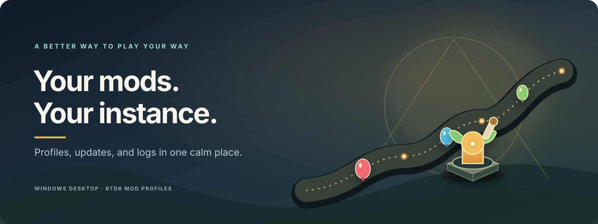
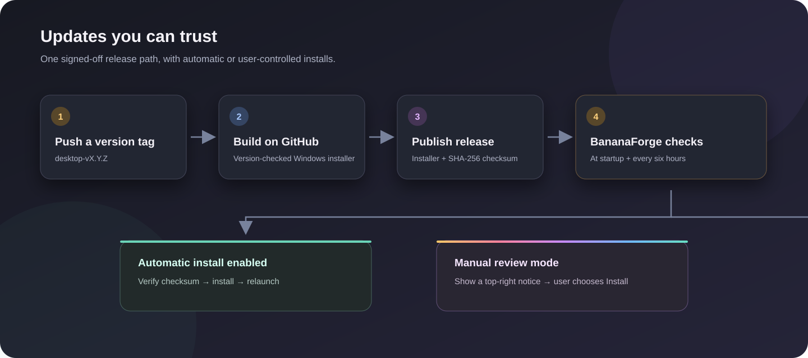

# BananaForge

<p align="center">
  
</p>

<p align="center">
  <a href="https://github.com/B1progame/bananaforge-launcher/releases"></a>
  <a href="https://github.com/B1progame/bananaforge-launcher/actions/workflows/desktop-release.yml"></a>
  <a href="LICENSE"></a>
  
</p>

**BananaForge is a Windows desktop launcher and profile manager for Bloons TD 6 mods.** Keep mod collections separate, inspect game logs, install DLLs from GitHub, and launch through a managed game copy.

> BananaForge and BTD6 modding are unofficial. Mods may crash the game or stop working after updates. Back up your saves, and avoid gameplay-changing mods in races, ranked events, public multiplayer, or other competitive modes. BananaForge does not bypass DRM, ownership checks, or storefront authentication.

## Download

Get the latest Windows installer from [GitHub Releases](https://github.com/B1progame/bananaforge-launcher/releases). The desktop release includes a versioned `BananaForge-Setup-X.Y.Z.exe` and a matching `.sha256` checksum file.

## What you can do

| Area | Features |
| --- | --- |
| **Profiles** | Keep mod collections separate, enable or disable individual DLLs, export and import profile packages. |
| **Mod installation** | Browse mods, install a downloaded DLL, or paste a GitHub project, folder, release, or direct DLL link. Downloads are checked before they are staged into the selected profile. |
| **Updates** | Check known mod sources, choose automatic mod updates, and choose whether BananaForge itself should install verified GitHub releases automatically. Manual app checks let you review an available release before installing. |
| **Game setup** | Select the Steam copy and a separate managed BTD6 location. Game updates flow from Steam into the managed copy; BananaForge does not copy managed files back into Steam. |
| **Troubleshooting** | Follow MelonLoader and Unity logs, filter errors, inspect detected mod failures, and disable a problematic mod from the notification. |

<p align="center">
  
</p>

## Install and set up

1. Download and run the installer from [Releases](https://github.com/B1progame/bananaforge-launcher/releases).
2. Open BananaForge and select your original BTD6 installation and managed game location in **Install & setup**.
3. Install MelonLoader into the managed copy, then create or select a profile and add mods.
4. Launch BTD6 through BananaForge so the selected profile is staged into the managed instance.

Keep enough free disk space for a separate managed game copy. The Steam installation remains the source of game updates.

## Self-updating desktop releases

BananaForge checks published `desktop-vX.Y.Z` GitHub Releases at startup and every six hours when **Automatically install BananaForge updates** is enabled. Before updating, it verifies the versioned Windows installer against the release SHA-256 digest or checksum asset. The update runs the per-user installer and relaunches BananaForge.

With automatic installation disabled, use **Settings → BananaForge & BTD6 → Check for updates**. An available version appears as a top-right notice with an **Install update** action. A manual check never installs an update by itself.

<p align="center"></p>

To publish a desktop release, update the version in `desktop/package.json` and `desktop/package-lock.json`, commit the change, then push a matching tag such as `desktop-v0.3.29`. The `desktop-release` GitHub Actions workflow verifies the tag/version match, builds the app and installer, creates the checksum, and publishes both installer assets to GitHub Releases.

## Build from source

Requirements: Windows, Node.js 22 or later, and Inno Setup 6 for creating the installer.

```powershell
cd desktop
npm ci
npm run check
npm start
```

To build the packaged app and installer from the repository root:

```powershell
./scripts/build-desktop.ps1
```

See [development and release notes](docs/development.md) for release steps and [update behavior](docs/updates.md) for how managed game and mod updates work.

## Project layout

- `desktop/` — Electron application, renderer, profile and download services.
- `installer/` — Windows installer definitions.
- `scripts/` — local build tooling.
- `docs/` — setup, safety, architecture, and troubleshooting guides.
- `launcher/` and `bootstrap/` — legacy Python launcher and verified bootstrap components.

## Support and contributions

Read [CONTRIBUTING.md](CONTRIBUTING.md) before opening a pull request. Please include BananaForge version, Windows version, reproduction steps, and a redacted log when reporting a problem. Never post Steam credentials, tokens, or personal save files.

See the [security policy](SECURITY.md) for reporting security issues. BananaForge is community software and is not affiliated with Ninja Kiwi, Valve, Steam, or MelonLoader.
